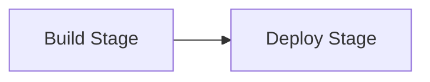

# Pipelines

Every time you push code to a connected repository, Planton runs a pipeline — an automated workflow that builds your code into a deployable artifact and rolls it out to your configured environments. Pipelines are the engine behind Service Hub: they take a Git commit and turn it into a running deployment, handling image building, artifact storage, and multi-environment rollout without manual intervention.

## Why Pipelines Exist

Without pipelines, deploying a service means manually building a container image, pushing it to a registry, updating deployment manifests, and applying them to each environment — repeating the process for every commit and every target. Pipelines automate this entire path. You push code, and your service is built using your configured method, and deployed to the environments you specified — in order, with approval gates where you need them.

## How a Pipeline Works

A pipeline progresses through two stages:



### Build Stage

The build stage transforms your source code into a deployable artifact. For platform-managed pipelines, this includes:

1. **Clone** — Fetch the repository (with sparse checkout for monorepos).
2. **Build** — Create the artifact using your configured build method — Cloud Native Buildpacks or Dockerfile for container images, or bundling for Cloudflare Workers.
3. **Push** — Store the artifact in your configured container registry or R2 bucket.

Build logs stream in real time through the web console and CLI. If the build fails, diagnostic information is available in the pipeline detail view.

For self-managed pipelines, the build stage runs your custom Tekton pipeline instead. See [Self-Managed Pipelines](/docs/ci-cd/self-managed-pipelines).

### Deploy Stage

The deploy stage rolls out the built artifact to each configured environment. Environments are deployed sequentially, following your organization's promotion policy (for example: dev, then staging, then production).

For each environment, the deploy stage applies the service's Infra Components, each through an Infra Job — an atomic infrastructure operation. Only the resources whose inputs moved since their last successful deploy run a job. The rest read **Unchanged since Run #126**, naming the run whose job last applied them, and run nothing; a resource whose lifecycle events are disabled reads **Unmanaged** and is left alone. The deployment record lists every resource with what happened to it. To apply every resource anyway, deploy, promote, roll back or redeploy with `--reapply-all` (**Re-apply Every Resource** in the console's Promote, Roll Back and Redeploy dialogs).

Within an environment, Planton walks the service's resources as a graph, with the same engine that applies an Infra Stack: a resource starts as soon as everything it depends on has succeeded, so independent resources apply side by side. If a resource fails, everything that depends on it ends at once, reading "Not run: AwsRdsInstance/orders-db failed", while independent resources carry on.

The pipeline waits for each environment to complete before proceeding to the next. If a deployment fails, subsequent environments are skipped.

When two runs of a service reach the same environment, the newer commit always lands last. A newer run waits for an older run still deploying there — "Waiting for Run #127 to finish deploying prod." — however long that takes, and never deploys over it. A run started by a push gives the environment up to a newer run that already reached it, ending there with a sentence that names the newer run.

This sequential model exists for a reason: each environment can depend on the previous one succeeding (you do not want a broken build reaching production), and failure at any stage stops the rollout cleanly rather than leaving partial deployments across environments.

<!-- SCREENSHOT: Pipeline detail view
  Page: /{org}/service/{slug}/runs/{runId}
  Action: Show a pipeline in progress with build stage completed and deploy stage running
  Focus: The pipeline detail view showing build and deploy stages with task status
  Alt: Pipeline detail view showing completed build stage and in-progress deploy stage with per-environment deployment tasks
-->

## Run Numbers

Every run gets a number within its service when it is created: the service's first run is Run #1, and each run after it, whatever started it, takes the next number. The number is the handle people say and type — "Run #128" on the Runs tab, the run page, notifications, and the title of the run's GitHub check — while the run's id (`svcpipe_…`) is for machines. Every CLI run verb takes either:

```bash
planton service logs my-service 128
planton service logs svcpipe_01k7m3pr5fxmjx3jy7w5afnw6a
```

A run that failed to be created leaves a gap in the numbers; the number names a run, it does not count them. Runs carry their origin too: a promotion reads "Promoted from staging · Run #129", naming the run it came from, and every deployment names the run that built its image ("Built by Run #128"), unchanged through every promotion and rollback.

## Pipeline Triggers

### Branch Pushes

By default, pushes to the service's default branch trigger a pipeline. You can configure additional branches in the pipeline settings — only pushes to configured branches will trigger builds.

A service that should never walk every environment from a branch push sets `build.triggers.disableTriggerBranches: true` (**Tags and Mapped Branches Only** on the Branches row of **Build Triggers**). No branch starts its promotion walk, and an empty branch list no longer falls back to the default branch. Tag pushes still release, and every branch mapped to an environment in `deploy.branchDeployments` still builds and deploys into its one environment; a push to any other branch is skipped, with the reason on the record. This is the shape for a service released by tags, or by merging between mapped branches. The setting cannot sit beside a list of trigger branches, which it contradicts.

### Pull Requests

Pull request pipelines can be configured independently for two levels:

- **Build only** — The pipeline builds the artifact but does not deploy it. Useful for validating that the code compiles and the image builds successfully before merging.
- **Build and deploy** — Every pull request gets its own **preview environment**: a real, short-lived environment named `{service}-pr-{number}`, born from the environment the PR's target branch deploys to. The changed service deploys into it alone — configuration references resolve against the base environment's stable instances — and rollout verification stamps a working URL that you, or the agent that authored the pull request, can check before review. Closing the PR destroys the preview's Infra Components first and its records after; an untouched preview expires on its own (72 hours by default, tunable per service with `previewTtlHours`), so an abandoned pull request never leaks cloud spend.

For kustomize-maintained services, preview deploys open when the repository authors a `previews/<env>` directory in its `_kustomize` tree declaring what previews change. Without one, PR pipelines build and skip the deploy, naming the exact path to author. Check any pull request's preview with one call:

```bash
planton service previews my-service --pr 123
```

The answer carries the preview's phase in plain words (building, live, torn down, …), the verified URL, and the rollout verdict.

PR pipelines trigger when the pull request targets a configured branch.

### Tag Pushes

Tag-triggered pipelines follow the same two levels — build only, or build and deploy. When tag pipelines are enabled, you can filter which tags trigger them using glob patterns (for example, `v*` or `release-*`). If no patterns are specified, all tags trigger.

For tag-triggered builds, the platform's Dockerfile and Buildpacks builders push the image under its commit SHA like every build, and also under the tag name (for example, `v1.0.0`) on the same digest, so the registry itself answers which image a release is. The run records the release tag beside the image, and `planton follow` says `Also tagged v1.0.0`. A Git tag an image tag cannot carry — image tags allow letters, digits, `_`, `.` and `-`, up to 128 characters, so `release/1.4` is not one — is pushed under its commit only, and the build says so:

```text
The release tag release/1.4 isn't a valid image tag (letters, digits, '_', '.' and '-', up to 128), so the image is pushed under its commit only.
```

### Manual Triggers

You can trigger a pipeline at any time from the CLI or web console, regardless of whether a new commit exists:

```bash
# Build the head of a branch
planton service run my-service --branch main

# Build a specific commit
planton service run my-service --branch main --commit a3f4c2b

# Build and deploy into exactly one environment (no promotion walk)
planton service run my-service --branch main --deploy-env dev

# Release a tag, exactly as if it had just been pushed
planton service run my-service --tag v1.4.0
```

`--tag` runs a tag release: it builds the tagged commit and walks every environment in promotion order, gates included, just as the tag push would have. It is its own choice — it cannot be combined with `--branch` or `--commit` — and it is refused when the service's tag triggers are off or when the tag matches none of its tag patterns. A service with no trigger branch has no default branch head to fall back on, so a run naming nothing is refused with the command to use instead:

```text
service 'my-service' has no trigger branch to build by default, so name what to run: planton service run my-service --tag <tag> (or --branch <branch>)
```

A branch mapped to an environment (`deploy.branchDeployments`) deploys there, exactly as its push would, unless `--deploy-env` names another. On a service with no trigger branch only a tag release walks the environments, so a run by commit must say where it deploys — `--branch` for the environment that branch is mapped to, or `--deploy-env` — and alone it is refused:

```text
service 'my-service' has no promotion walk, so a run by commit deploys only where you name: add --deploy-env <env>, or --branch <branch> to deploy where that branch is mapped (dev → dev, main → prod)
```

A branch, tag or commit the repository does not have is refused naming it and the repository.

In the web console, the **Run** button on the service's **Runs** tab opens the same choice: the trigger branch's head by default, another branch (a mapped branch needs no environment chosen — the dialog says where it deploys), or — when the service's tag triggers are on — **Release a Tag**, picked from the repository's tags that the service's patterns accept, newest first (type to narrow, or name a tag the list doesn't show). For a service with no trigger branch there is no head to build by default, so the dialog opens on the tag (or, with tags off, the branch) and waits for one to be named.

## Controlling Pipeline Behavior

Two settings give you fine-grained control over pipeline execution:

- **Disable pipelines entirely** — Prevents all pipeline execution, including both webhook-triggered and manual pipelines. Useful for temporarily pausing automation during maintenance windows or incident response.
- **Disable deployments only** — Pipelines still run the build stage (your artifact is built and pushed), but the deploy stage is skipped. Useful for validating builds without affecting running environments.

Both settings are available on the service's **Configuration** tab in the web console.

## Manual Approval Gates

Deployment targets can require manual approval before the pipeline deploys to that environment. A gate is enforced when you enable manual approval on a deployment target, or when your organization's promotion policy mandates approval for that environment.

When a pipeline reaches a gated environment:

1. The pipeline pauses and shows the environment as awaiting approval.
2. A team member approves or rejects through the web console or CLI.
3. On approval, the deployment proceeds. On rejection, the deployment and all subsequent environments are skipped.

```bash
# Approve a manual gate (the run by its service and number, or by its id)
planton service resolve-env-manual-gate my-service 130 prod yes

# Reject a manual gate
planton service resolve-env-manual-gate my-service 130 prod no
```

When the run no longer declares resources the service deployed to that environment, the gate lists each removal, and approving decides them all: each one is destroyed unless you keep it. A resource that holds data must be kept or named before the approval goes through. A removal that appears after the approval, or whose resource was replaced since, asks on its own. See [Removing a Resource](/docs/ci-cd/what-is-a-service#removing-a-resource).

```bash
# Approve, keeping the cache on its provider and naming the database to destroy
planton service resolve-env-manual-gate my-service 130 prod approve \
  --keep AwsElasticacheCluster/orders-cache --destroy AwsRdsInstance/orders-db
```

## Cancelling a Pipeline

Running pipelines can be cancelled at any point. The behavior depends on which stage is active:

- **During the build stage** — Running build processes are terminated immediately. The deploy stage is skipped entirely.
- **During the deploy stage** — Nothing new starts, every running Infra Job is asked to stop, and the run waits for the jobs to really end before it reads Cancelled. Each resource then says what its job truly did: one that finished before the cancel reached it keeps its success, and one that outlived the wait reads "Cancel requested; infra job … was still running".

```bash
planton service cancel my-service 130
```

The command answers once the run confirms it took the cancel. A run that does not answer is stopped and ended by the platform, with its jobs stopped too, so a cancel always lands.

## Monitoring Pipelines

### Web Console

The **Runs** tab on the service's page lists every run, newest first, with:

- The run's number ("Run #128"), or a CI run's workflow name
- Commit SHA and message
- Pipeline type (Preview for pull requests, Production for branch/tag pushes)
- Status (running, succeeded, failed, cancelled)
- Duration and relative time
- Branch and author

Click any run to see its page with build and deploy stage logs. The list updates live: a run started from the CLI, an agent, or a push appears within a second, with no reload.

<!-- SCREENSHOT: Pipeline list in web console
  Page: /{org}/service/{slug}?view=runs (Runs tab)
  Action: Show the pipeline runs table with at least 3 pipelines in different states
  Focus: The pipeline runs table with status indicators, branch, and commit columns
  Alt: Pipeline runs table showing recent pipelines with status badges, branch names, commit SHAs, and trigger pipeline button
-->

### CLI

```bash
# Everything that ran for a service, newest first (Planton runs and the repo's own CI)
planton service runs my-service

# Planton-managed runs only; or the ones paused on your approval
planton service pipelines my-service
planton service pipelines --awaiting-my-approval

# Where each environment stands: its build, distance, and runs in flight
planton service status my-service

# Follow a run's build and deploy progress live (by its number, or its id)
planton service follow my-service 128

# The build's logs (every task's lines); a deploy node's engine logs
planton service logs my-service 128
planton service logs my-service 128 --env dev --node KubernetesDeployment/my-service

# The most recent run for a service
planton service last-pipeline my-service

# Re-run a build byte-identically (the same compiled pipeline, the same params)
planton service rerun my-service 128
```

A rerun repeats a build. A promotion, a rollback, a redeploy, or a deploy of an image built nothing, so rerunning one is refused, and the refusal names the command that repeats it:

```text
Run #129 promoted 'Fix login' from dev to staging; running it again would rebuild the commit instead of promoting it. Promote again: planton service promote my-service --from dev --to staging, or Promote on the service's Delivery Path.
```

### GitHub Integration

The integration is rich in both directions. Inbound: if your repository runs its own GitHub Actions workflows, those runs are mirrored into Planton automatically — they render beside Planton-managed pipeline runs in one chronology (`planton service runs`, the service's Runs tab in the console), each with its jobs, steps, GitHub's own status words, and job logs on view, no setup beyond connecting the repository. You can act on them from Planton too, at GitHub's own granularities: re-run all jobs, re-run only the failed jobs, re-run one job, or cancel an in-flight run (`planton service rerun` / `planton service cancel`, the run page's controls, or the agent tools), each optionally with GitHub's debug logging for the new attempt.

Outbound, Planton's facts land on GitHub's own surfaces. Every pipeline run writes a live check on its commit — named by the service (so a required check keeps matching), titled with the run's number ("Run #128 · Deploying to staging"), visible from the moment a push triggers work, concluding with the run's verdict and the whole delivery story (build outcome, each environment's outcome with its reason) in the check's output, with "Details" opening the run in Planton. Every successful deploy advances a GitHub Deployment, so the repository's environments panel shows what is running where and "View deployment" opens the live address; a pull request's preview additionally gets a "Preview" check carrying the preview's phase and URL, and its deployment goes inactive when the preview is torn down. Even a broken `service.yaml` pushed to the default branch gets failed-CI ergonomics: a red X on that exact commit naming the exact error — including files so broken they name no service at all — with the error pinned to its line in the diff when the parser reports one. Status checks land on PRs with no configuration; the GitHub App's Checks and Deployments write permissions are the only requirement.

GitHub Actions can also be the deploy platform itself: the published Deploy Action runs connected through your backend or entirely offline with no backend anywhere — see [Deploy from GitHub Actions](/docs/ci-cd/deploy-from-github-actions).

## Related Documentation

- [What is a Service?](/docs/ci-cd/what-is-a-service) — Service configuration including pipeline settings
- [Deploy from GitHub Actions](/docs/ci-cd/deploy-from-github-actions) — The published Deploy Action, offline and connected
- [Trusted Workflows](/docs/ci-cd/trusted-workflows) — Let a repository's workflows register and deploy with no stored key
- [Build Methods](/docs/ci-cd/build-methods) — How artifacts are built during the build stage
- [Self-Managed Pipelines](/docs/ci-cd/self-managed-pipelines) — Custom Tekton pipeline definitions
- [Deployment Targets](/docs/ci-cd/deployment-targets) — Where the deploy stage provisions resources
- [Monorepo Support](/docs/ci-cd/monorepo-support) — How trigger paths and sparse checkout affect pipelines
