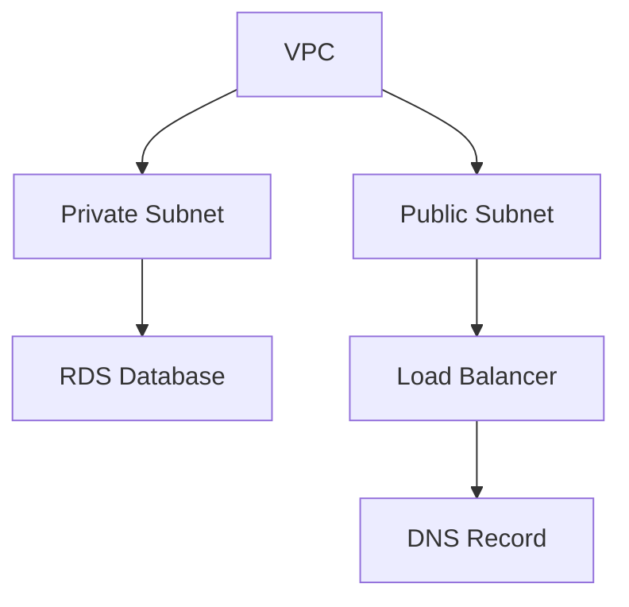

# Infra Pipelines

An Infra Pipeline coordinates the deployment of multiple Infra Components in the right order. When an Infra Stack defines resources that depend on each other — a VPC that must exist before the database inside it, a security group that must exist before the load balancer that references it — the Infra Pipeline figures out the order, deploys independent resources in parallel (up to four at once), and waits for dependencies to complete before starting their dependents.

## Why Infra Pipelines Exist

Deploying a single Infra Component is straightforward — define it, submit it, and an Infra Job provisions it. But real environments rarely consist of a single resource. An AWS environment might include a VPC, subnets, security groups, an ECS cluster, a load balancer, Route 53 records, and an ACM certificate — with specific dependency relationships between them.

Without orchestration, you would deploy each resource manually, wait for it to complete, copy output values (like a VPC ID) into the next resource's configuration, and repeat. Sequential, error-prone, and slow.

Infra Pipelines automate this. They read the dependency graph from the Infra Stack, deploy independent resources in parallel, pass outputs from completed resources to their dependents, and give you a single view of the entire deployment's progress. What might take 25 minutes of sequential manual work completes in roughly half the time with parallel execution.

## How It Works

When an Infra Stack is created or updated, the system generates an Infra Pipeline from the stack's dependency graph (DAG). Each node in the graph is an Infra Component; each edge is a dependency where one resource needs an output from another.

The pipeline executes the graph:

1. Resources with no dependencies start first, in parallel.
2. When a resource completes, its dependents become eligible; each starts once everything it consumes has finished and a slot is free.
3. Independent branches of the graph execute concurrently, with at most **four resources holding work at once** per run. A job waiting for its runner holds its slot; a resource waiting for a person — at its gate, or on its job's own approval — does not, so the rest of the graph carries on.
4. Each resource whose inputs moved since its last successful deploy runs as a separate [Infra Job](/docs/infrastructure/infra-jobs). A resource whose inputs match exactly runs no job: it reads **Unchanged since** the job that last applied it and passes that job's outputs to its dependents (see [What a Run Applies](/docs/infrastructure/infra-stacks#what-a-run-applies)).
5. If a resource fails, everything downstream of it ends at once and reads **Not run: <Kind>/<slug> failed**. Branches that do not depend on it keep running.



In this example, the VPC deploys first. Once it completes, both subnets start in parallel. The database waits for the private subnet; the load balancer waits for the public subnet. The DNS record waits for the load balancer.

<!-- SCREENSHOT: Infra Pipeline DAG visualization
  Page: /resource/infra-hub/infra-pipeline (DAG graph component)
  Action: Show a running pipeline with some nodes completed, some in progress, and some pending
  Focus: The DAG graph with node status indicators
  Alt: Infra Pipeline DAG visualization showing an AWS environment deployment with VPC completed, subnets in progress, and RDS pending
-->

## Operation Types

Infra Pipelines support two operations:

- **Deploy** — Create or update Infra Components, each after everything it consumes. This is the default, triggered by every save of an Infra Stack (create, update, apply, `planton chart install`) and by an explicit redeploy. A save never destroys anything.
- **Undeploy** — Destroy everything the stack owns, in reverse dependency order: each resource after everything that consumes it, so the database is destroyed before the VPC it sits in, and a cluster outlives the workloads on it. An undeploy covers every Infra Component the stack created, including components its templates no longer declare, and reads each resource from its stored record rather than from the templates.

In both, a resource the stack holds as **Unmanaged** (`planton.dev/infra-job.disable-on-lifecycle-events: "true"`) runs no job: a deploy leaves it alone, and an undeploy releases it from the stack and leaves it in the cloud, never destroying it. A resource another live stack or service owns reads **Owned elsewhere**: an undeploy leaves it in place for its owner, and a deploy that would change it is refused. In an undeploy, a resource whose record is already gone reads **Already Gone**.

A stack has one run at a time. A save, deploy, undeploy, purge or rerun is refused while a run of that stack is queued, running or waiting for approval, and the refusal names that run: approve or reject it, or cancel it with `planton infra pipeline cancel <pipeline-id>`, then try again. A run's record cannot be deleted while the run is in flight. A run whose workflow is gone — it never started, or stopped without finishing — is ended by the platform within about ten minutes, so a stack is never left busy.

Rerunning a finished run repeats its operation: a deploy reruns as a deploy, an undeploy as an undeploy of everything the stack owns. Rerunning an undeploy needs destroy access on the stack, just like an undeploy.

## Manual Approval Gates

Infra Pipelines support approval gates at two levels, giving you control over when deployments proceed.

### Environment-Level Gates

An environment within the pipeline can require manual approval before any of its resources start. A protected environment asks here, for a deploy and an undeploy alike. When a gate is active, the pipeline pauses and waits for a team member to approve or reject.

```bash
planton infra pipeline resolve-env-manual-gate <pipeline-id> <env-name> yes
```

### Node-Level Gates

Individual resources within the dependency graph can have their own gates: annotate the resource with `planton.dev/gate.type: manual`. The resource pauses before it runs or after it succeeds (`planton.dev/gate.position`, after by default) until someone approves or rejects, while the rest of the graph carries on. A gate after a resource lets you verify its deployment before its dependents start; a rejection fails the resource. Only a deploy pauses at a resource's gate.

```bash
planton infra pipeline resolve-node-manual-gate <pipeline-id> <env-name> <node-id> yes
```

### What an Approval Answers

Approving or rejecting a gate answers at once with what became of the decision:

- **Applied** — the run continues, or the rejected resource fails.
- **Refused, with the reason** — the gate was already decided by someone else (the first decision stands), it is not waiting for a decision yet, or the run is being cancelled.
- **The run has ended** — there is nothing left to decide.
- **Not confirmed in time** — the decision may still apply; check the run before trying again.

The decision, who made it, and their note are recorded where the gate is: an environment gate's on the environment, a resource gate's on that resource.

<!-- SCREENSHOT: Pipeline with manual gate awaiting approval
  Page: /resource/infra-hub/infra-pipeline (DAG graph component)
  Action: Show a pipeline paused at a manual gate with an approval prompt visible
  Focus: The gate approval UI element
  Alt: Infra Pipeline paused at a manual approval gate showing approve/reject buttons
-->

## Monitoring Progress

The web console displays the dependency graph with real-time status updates for each resource. Completed resources are marked as successful, active deployments show as in progress, and pending resources wait for their dependencies. Click any resource node to drill down to its Infra Job logs; an unchanged resource links to the job that last applied it.

The pipeline detail view shows the full graph along with timing information — when each resource started, how long it took, and the overall pipeline duration.

## Cancelling a Pipeline

A cancel always ends the run. Nothing new starts, every live Infra Job is asked to stop, and the run waits up to three minutes for them to really end, so each resource reads what its job truly did: a job that finished before the stop reached it is still a success. A job still running after the wait is named on its resource ("Cancel requested; infra job … was still running"). If the run's workflow does not answer the cancel, the platform stops it and ends the run itself.

```bash
planton infra pipeline cancel <pipeline-id>
```

The web console provides a cancel button with a confirmation dialog. Cancelling a run that has already ended changes nothing.

## Pipeline vs Direct Deployment

| Aspect | Direct Deployment | Infra Pipeline |
|--------|------------------|----------------|
| Scope | Single Infra Component | Multiple Infra Components |
| Dependencies | None — each resource is independent | Automatic — resources deploy in dependency order |
| Execution | One Infra Job | One Infra Job per resource that changed, up to four at once |
| Approval | Per-resource | Environment-level and per-resource gates |
| Tracking | Individual Infra Job status | Unified view across all resources |

Use direct deployment for standalone resources. Use Infra Pipelines (via [Infra Stacks](/docs/infrastructure/infra-stacks)) when resources depend on each other or when you need coordinated, multi-resource deployments.

## Using the CLI

```bash
# Cancel a running pipeline
planton infra pipeline cancel <pipeline-id>

# Approve an environment gate (yes or no)
planton infra pipeline resolve-env-manual-gate <pipeline-id> <env-name> yes

# Approve a resource-level gate (yes or no)
planton infra pipeline resolve-node-manual-gate <pipeline-id> <env-name> <node-id> yes
```

Infra Pipelines are created automatically when you create or update an Infra Stack. To trigger a pipeline manually:

```bash
# Deploy an Infra Stack (starts a deploy run and follows it)
planton infra stack deploy <stack-id>

# List pipelines for a stack
planton infra stack infra-pipelines <stack-name-or-id>

# Get the last pipeline for a stack
planton infra stack last-pipeline <stack-name-or-id>
```

## Related Documentation

- [Infra Stacks](/docs/infrastructure/infra-stacks) — The deployed stacks that pipelines deploy and undeploy
- [Infra Components](/docs/infrastructure/infra-components) — The resources deployed by pipelines
- [Infra Jobs](/docs/infrastructure/infra-jobs) — The atomic IaC execution units within pipelines
- [Flow Control](/docs/infrastructure/flow-control) — Governance policies for approval gates
- [Infra Charts](/docs/infrastructure/infra-charts) — Templates that define the resources an Infra Stack deploys
