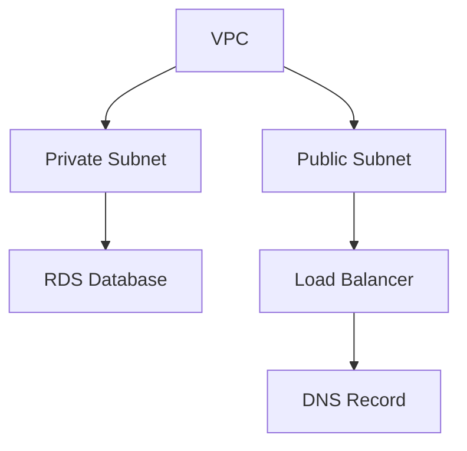

# Infra Pipelines

An Infra Pipeline coordinates the deployment of multiple Infra Components in the right order. When an Infra Stack defines resources that depend on each other — a VPC that must exist before the database inside it, a security group that must exist before the load balancer that references it — the Infra Pipeline figures out the order, deploys independent resources in parallel (up to four at once), and waits for dependencies to complete before starting their dependents.

## Why Infra Pipelines Exist

Deploying a single Infra Component is straightforward — define it, submit it, and an Infra Job provisions it. But real environments rarely consist of a single resource. An AWS environment might include a VPC, subnets, security groups, an ECS cluster, a load balancer, Route 53 records, and an ACM certificate — with specific dependency relationships between them.

Without orchestration, you would deploy each resource manually, wait for it to complete, copy output values (like a VPC ID) into the next resource's configuration, and repeat. Sequential, error-prone, and slow.

Infra Pipelines automate this. They read the dependency graph from the Infra Stack, deploy independent resources in parallel, pass outputs from completed resources to their dependents, and give you a single view of the entire deployment's progress. What might take 25 minutes of sequential manual work completes in roughly half the time with parallel execution.

## How It Works

When a plan of an Infra Stack is applied, the platform starts an Infra Pipeline over the plan's graph (DAG): the resources the stack declares, and beside them the resources the plan removes. Each node is an Infra Component, carrying what the reviewed plan said it does; each edge is a dependency where one resource needs an output from another.

The pipeline executes the graph:

1. Resources with no dependencies start first, in parallel.
2. When a resource completes, its dependents become eligible; each starts once everything it consumes has finished and a slot is free.
3. Independent branches of the graph execute concurrently, with at most **four resources holding work at once** per run. A job waiting for its runner holds its slot; a resource waiting for a person — at its gate, or on its job's own approval — does not, so the rest of the graph carries on.
4. Each resource whose inputs moved since its last successful deploy runs as a separate [Infra Job](/docs/infrastructure/infra-jobs). A resource whose inputs match exactly runs no job: it reads **Unchanged since r11**, the revision whose run last applied it, and passes that job's outputs to its dependents (see [What a Run Applies](/docs/infrastructure/infra-stacks#what-a-run-applies)).
5. If a resource fails, everything downstream of it ends at once and reads **Not run: <Kind>/<slug> failed**. Branches that do not depend on it keep running.
6. Only when everything the stack declares applied, the resources the plan removed are taken down in reverse dependency order: destroyed, or let go of and **Kept**, as the person chose. A failed apply removes nothing; its removals read **Not run: nothing is removed while what the stack declares did not all apply**.



In this example, the VPC deploys first. Once it completes, both subnets start in parallel. The database waits for the private subnet; the load balancer waits for the public subnet. The DNS record waits for the load balancer.

<!-- SCREENSHOT: Infra Pipeline DAG visualization
  Page: /resource/infra-hub/infra-pipeline (DAG graph component)
  Action: Show a running pipeline with some nodes completed, some in progress, and some pending
  Focus: The DAG graph with node status indicators
  Alt: Infra Pipeline DAG visualization showing an AWS environment deployment with VPC completed, subnets in progress, and RDS pending
-->

## Operation Types

Infra Pipelines support two operations:

- **Deploy** — Apply a stack's plan: create or update Infra Components, each after everything it consumes, then remove what the plan removed. Started by every applied plan that changes a resource (`planton infra stack apply`, `planton chart install`, `promote`, `rollback`, `upgrade`, `reconcile`, **Apply** in the console), and named by the revision it applies ("r12 · Raise replicas"). A run whose revision came by promotion, roll back, upgrade or reconcile says so beside its name — "r16 · Raise replicas · Promoted from staging r6", "Rolled back to r8", "Upgraded to app-infra v5", "Reconciled drift on orders-db and cache" — on its page, on the phone, in the activity feed and in notifications. Promote, roll back, upgrade and reconcile are plans, not pipelines of their own: their runs are ordinary deploys. A run whose only failures were removals ends **Applied; 1 removal failed**: what the stack declares is live.
- **Undeploy** — Destroy everything the stack owns, in reverse dependency order: each resource after everything that consumes it, so the database is destroyed before the VPC it sits in, and a cluster outlives the workloads on it. An undeploy covers every Infra Component the stack created, including components its templates no longer declare, and reads each resource from its stored record rather than from the templates.

In both, a resource the stack holds as **Unmanaged** (`planton.dev/infra-job.disable-on-lifecycle-events: "true"`) runs no job: a deploy leaves it alone, and a teardown releases it from the stack and leaves it on its provider, never destroying it — as it does any resource marked `planton.dev/keep-on-provider: "true"`. A resource another live stack or service owns reads **Owned Elsewhere** and is left in place for its owner. A resource whose record is already gone reads **Already Gone**.

Before a run reads ended, it settles its revision: Applied (the stack's live revision moves to it), Applied With Removal Failures, Failed or Cancelled. An undeploy clears the stack's live revision.

A stack has one run at a time. An apply, undeploy, purge or rerun is refused while a run of that stack is queued, running or waiting for approval, and the refusal names that run — or the request waiting for approval, with the commands to review or withdraw it; cancel a run with `planton infra pipeline cancel <pipeline-id>`, then try again. A run's record cannot be deleted while the run is in flight. A run whose workflow is gone — it never started, or stopped without finishing — is ended by the platform within about ten minutes, so a stack is never left busy.

Rerunning a finished run repeats its operation. A deploy reruns its revision — the same reviewed plan, from the graph its last run walked — so what applied stays Unchanged and what failed runs again; it is refused, saying to plan again, once the stack has a newer revision or was undeployed since. An undeploy reruns as an undeploy of everything the stack owns. Rerunning anything that destroys — an undeploy, or a revision that removes resources — needs destroy access on the stack. Rerun from the run's page, with `planton infra pipeline rerun <pipeline-id>` (it asks first when the rerun still destroys something; `--yes` answers), or through the agents' `rerun_infra_pipeline`.

## Approvals

### Requests in a Protected Environment

In a protected environment a stack's run is a **request**, for a deploy and an undeploy alike. The run first previews what the change reaches: one preview job per resource it changes first, each showing its engine's plan and changing nothing. Once every preview finished, the review opens and the run waits for an approver, who reads that exact plan — destroys and replaces first — and approves or rejects it with a reason. Only an approval applies, and each resource proves its plan is the one previewed before it changes; one that moved since stops before changing anything, shows its new plan and waits for a person, and a resource that could only be previewed once an earlier change applied applies under the approval unless its plan destroys or replaces something. A rejected, withdrawn or lapsed request (nobody decided it within 7 days) ends having applied nothing, and its run reads how it closed: **Rejected**, **Withdrawn**, **Lapsed**, **Preview Failed** or **Out of Date**.

```bash
planton infra stack review <stack-name> --env <env>
planton infra stack approve <stack-name> --env <env>
planton infra stack reject <stack-name> --env <env> --reason "why"
planton infra stack withdraw <stack-name> --env <env>
```

See [Infra Stacks](/docs/infrastructure/infra-stacks#in-a-protected-environment-a-change-is-a-request) for who may decide and how a request is planned again.

### Node-Level Gates

Individual resources within the dependency graph can have their own gates: annotate the resource with `planton.dev/gate.type: manual`. The resource pauses before it runs or after it succeeds (`planton.dev/gate.position`, after by default) until someone approves or rejects, while the rest of the graph carries on. A gate after a resource lets you verify its deployment before its dependents start; a rejection fails the resource. Only a deploy pauses at a resource's gate. An approval that lets the resource destroy or replace something says what goes and asks at a terminal; `--yes` answers ahead, and a rejection asks nothing.

```bash
planton infra pipeline resolve-node-manual-gate <pipeline-id> <env-name> <node-id> yes
```

### What a Decision Answers

Approving or rejecting answers at once with what became of the decision:

- **Applied** — the run continues, the request applies exactly the plan read, or the rejected resource fails.
- **Refused, with the reason** — it was already decided by someone else (the first decision stands), it is not waiting for a decision yet (a request still previewing), the review changed since it was read, or the run is being cancelled.
- **The run has ended** — there is nothing left to decide.
- **Not confirmed in time** — the decision may still apply; check the run before trying again.

The decision, who made it, and their reason are recorded where the decision lives: a request's on its run's review, a resource gate's on that resource.

<!-- SCREENSHOT: Pipeline with manual gate awaiting approval
  Page: /resource/infra-hub/infra-pipeline (DAG graph component)
  Action: Show a pipeline paused at a manual gate with an approval prompt visible
  Focus: The gate approval UI element
  Alt: Infra Pipeline paused at a manual approval gate showing approve/reject buttons
-->

## Monitoring Progress

The web console displays the dependency graph with real-time status updates for each resource. Completed resources are marked as successful, active deployments show as in progress, and pending resources wait for their dependencies. Click any resource node to drill down to its Infra Job logs; an unchanged resource links to the job that last applied it.

The pipeline detail view shows the full graph along with timing information — when each resource started, how long it took, and the overall pipeline duration.

A stack's page follows its runs live, in every environment: when a run starts — from the console, a terminal or a promotion landing from staging — or its status or review moves, the page re-reads at once, so its header, its Delivery Path and its Pipelines tab show the run without a refresh.

## Cancelling a Pipeline

A cancel always ends the run. Nothing new starts, every live Infra Job is asked to stop, and the run waits up to three minutes for them to really end, so each resource reads what its job truly did: a job that finished before the stop reached it is still a success. A job still running after the wait is named on its resource ("Cancel requested; infra job … was still running"). If the run's workflow does not answer the cancel, the platform stops it and ends the run itself.

```bash
planton infra pipeline cancel <pipeline-id>
```

The web console provides a cancel button with a confirmation dialog. Cancelling a run that has already ended changes nothing.

## Pipeline vs Direct Deployment

| Aspect | Direct Deployment | Infra Pipeline |
|--------|------------------|----------------|
| Scope | Single Infra Component | Multiple Infra Components |
| Dependencies | None — each resource is independent | Automatic — resources deploy in dependency order |
| Execution | One Infra Job | One Infra Job per resource that changed, up to four at once |
| Approval | Per-resource | A request reviewed on its exact plan, and per-resource gates |
| Tracking | Individual Infra Job status | Unified view across all resources |

Use direct deployment for standalone resources. Use Infra Pipelines (via [Infra Stacks](/docs/infrastructure/infra-stacks)) when resources depend on each other or when you need coordinated, multi-resource deployments.

## Using the CLI

```bash
# Cancel a running pipeline
planton infra pipeline cancel <pipeline-id>

# Run a finished run again: the same revision; asks when it destroys or replaces (--yes)
planton infra pipeline rerun <pipeline-id>

# Approve a resource-level gate (yes or no)
planton infra pipeline resolve-node-manual-gate <pipeline-id> <env-name> <node-id> yes
```

Infra Pipelines are started by their stack: an applied plan, an undeploy or a purge.

```bash
# Plan a stack, then apply exactly that plan (starts a run and follows it)
planton infra stack plan <stack-name> --env <env>
planton infra stack apply <stack-name> --env <env> -m "why"

# List pipelines for a stack
planton infra stack infra-pipelines <stack-name-or-id>

# Get the last pipeline for a stack
planton infra stack last-pipeline <stack-name-or-id>
```

## Related Documentation

- [Infra Stacks](/docs/infrastructure/infra-stacks) — The deployed stacks that pipelines deploy and undeploy
- [Infra Components](/docs/infrastructure/infra-components) — The resources deployed by pipelines
- [Infra Jobs](/docs/infrastructure/infra-jobs) — The atomic IaC execution units within pipelines
- [Flow Control](/docs/infrastructure/flow-control) — What a resource's annotations and a protected environment decide about how its jobs run
- [Infra Charts](/docs/infrastructure/infra-charts) — Templates that define the resources an Infra Stack deploys
